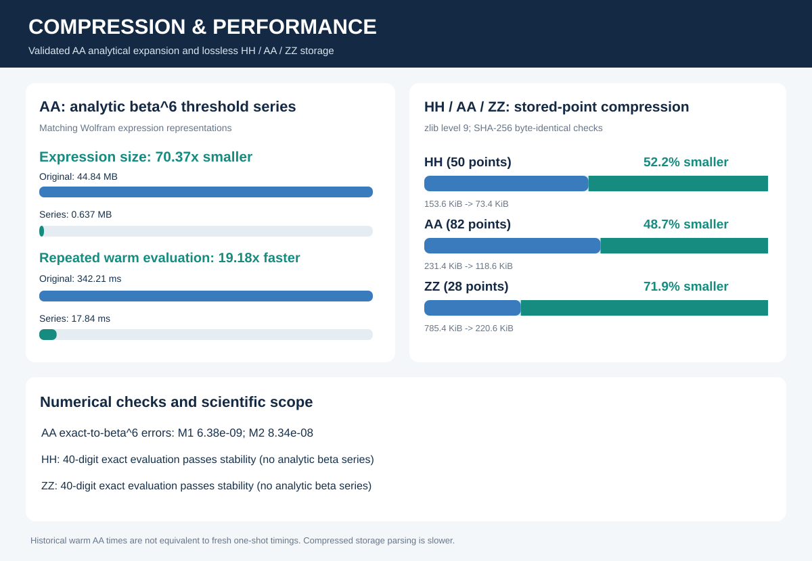

# Compression and Performance — independent module on main

**[Read the measured results, accuracy checks and source links](RESULTS.md)** · [Machine-readable benchmark snapshot](benchmark_snapshot.json)

<!-- PERFORMANCE_SUMMARY_START -->
> **What improves?** AA has a validated analytic β⁶ series with a 70.37× smaller expression and 19.18× faster historical warm evaluation. Lossless stored-point reductions are 52.22% (HH), 48.73% (AA), and 71.91% (ZZ). HH/ZZ analytic beta series are **not yet derived**. This summary and plot update following successful benchmark CI runs.
<!-- PERFORMANCE_SUMMARY_END -->

## Distinct scientific and storage questions

This is a self-contained HH/AA/ZZ research module inside the PRL repository. Its tests and outputs remain separate from the canonical Letter and Supplemental Material.

1. HH, AA, ZZ: point_benchmark.py implements byte-identical zlib storage
   and checks SHA-256, size and payload integrity on every decoded JSON point.
   It compares load-and-parse timings, NOT exact-amplitude evaluation.
2. AA: aa_threshold.py reads the independently published and validated
   ggAA-threshold beta^6 results, size and timing measurements. The historical
   timings are labelled as historical. An optional --fresh mode compares
   the exact and series evaluations with independently downloaded arXiv inputs.
3. HH/ZZ: no validated complete fixed-angle beta-series amplitude expressions
   are currently present. The included fixed-beta forward-limit fits and point
   records are not analytic beta series. Do not claim a numerical speedup
   from a missing beta expansion.

## Usage

Install requirements-pinned.txt, then from the PRL repository root:

    make compression-tests PY=python
    make compression-points PY=python

For the AA source data, checkout the independent project first:

    git clone https://github.com/abhattacharya1992/ggAA-threshold.git ggAA-threshold
    make compression-aa-recorded PY=python AA_REPO=ggAA-threshold

This reads the published timing_run.json, timing_benchmark.csv and
validation_1080.csv records, checking input SHA-256 and upstream Git SHA.
No additional amplitude files are tracked or copied into this repository.

For a *fresh* AA exact-vs-beta6 benchmark (requires full external inputs and
considerably longer evaluation time):

    (cd ggAA-threshold && bash inputs/fetch_inputs.sh)
    python compression/aa_threshold.py --aa-repo ggAA-threshold --fresh --beta 1/10 --costheta 1/3 --order 6 --digits 120 --repeats 1

The two AA amplitudes are compared in the same convention (exact divided by
64). The published historical timings also preserve the original CPU,
software and representations; do not substitute them for new measurements.

## HH and ZZ: still-open physics work

HH: derive a fixed-angle expansion of the relevant class-B full two-loop
remainders, keeping helicity and colour decomposition, before numerical
checks against the external Gauge1/2 expressions.

ZZ: derive and validate the corresponding threshold expansion of the full
massless-quark two-loop amplitudes, including all helicity and colour parts;
compare with the VVamp evaluator, not the fixed-beta small-pT DPS fits.

Both processes require independent validation over a bounded beta domain,
including withheld points, precision sensitivity, relative errors,
expression bytes, operation counts, preparation/evaluation time and memory.
This module does not fabricate those analytic coefficients.

The optional CI only runs lossless HH/AA/ZZ and published AA record checks.
It cannot claim that original third-party full amplitudes were recomputed.
All benchmark reports are generated outputs and ignored by Git. No existing
scientific numerical records or manuscript files are deleted or modified.

## Optional original exact-amplitude evaluations at fixed angle

The original HH and ZZ evaluator backends can be timed, but only after the
external published expressions are installed:

    make -C paper2/hh fetch
    make compression-exact-hh PY=python

For ZZ, first follow paper2/zz/README.md to install VVamp expressions and
translate them into paper2/zz/build/ggv, then:

    make compression-exact-zz PY=python

These commands use s=4/(1-beta^2), equal external mass squared 1, and
t/u=1-s/2 +/- s beta cos(theta)/2. Positive beta and 0 <= cos(theta) < 1
are required by the current ZZ helicity reconstruction convention.
They report preparation time, repeated evaluation time, expression/input
bytes, normalized amplitudes, source SHA-256 and process high-water RSS.

Run HH and ZZ in separate OS processes. RSS is the whole process high-water
mark, not the incremental cost of individual function calls. Results are
stored under compression-results/exact and ignored by Git. These exact
backend calls are opt-in and excluded from CI because the external expressions
are not distributed in this repository.

Do not compare HH and ZZ exact backend timings against the AA beta6 timing:
they are different physical processes, conventions and numerical workloads.
Direct HH/ZZ exact-vs-beta benchmarking requires their own validated series.

## Unified two-stage implementation

The single entry point combines the established HH/AA/ZZ adapters into one
experiment, rather than maintaining three unrelated reporting paths.

    make compression-unified PY=python AA_REPO=ggAA-threshold

Alternatively, run each stage independently:

    make compression-stage1 PY=python AA_REPO=ggAA-threshold
    make compression-stage2 PY=python

Stage 1 writes compression-results/unified/stage1.json. It really evaluates
the independently validated AA beta^4 and beta^6 series at fixed angle. It
also authenticates and measures every stored HH/AA/ZZ forward-point record.
For HH and ZZ the default Stage 1 status is not_derived for analytic beta
series, and not_run for original full evaluators. This is intentional and
must not be interpreted as an analytical result.

Use the explicit --run-exact flag on compression/unified_pipeline.py
for the optional full-amplitude backend, only after ALL required external
HH, AA and ZZ inputs are installed. A missing input is an error, never a
fallback to stored points.

Stage 2 checks the SHA-256 sealed Stage 1 JSON file and creates
compression-results/unified/{stage2.json,report.md}. It reports
point-data compression, loading runtime, actual AA series timing,
historical AA exact/series speedups, size measurements, and the entire
Stage 1 process peak RSS. It never reruns an evaluator. Exact HH/ZZ
versus their missing analytic beta expansions cannot yet be reported.

The engine is a unified driver and interface to existing evaluators, not
a new, validated multi-process symbolic beta-series construction engine.
A process-independent rational DAG/MPL series constructor and new HH/ZZ
analytic coefficients remain separate scientific development.

## Optional full HH/AA/ZZ amplitude performance workflow

The independent .github/workflows/full-performance.yml runs by
workflow_dispatch only: it will NEVER launch expensive external evaluations
on routine commits. When the workflow file is available on the default
GitHub branch, select Actions > Full HH AA ZZ amplitude performance (manual)
> Run workflow; choose aa, hh, zz or all. Each process runs separately,
with a two-hour safety timeout and separately uploaded JSON/Markdown reports.

AA: pin ggAA-threshold to the previously verified commit; fetch its published
two-loop exact expressions and evaluate the complete M1/M2 Type-II finite
remainders together with the validated beta^6 series. Report exact/series
runtime, input sizes and relative numerical errors on the same runner.

HH: fetch both published class-B Gauge{1,2} expressions, check their SHA-256,
compile and evaluate them at fixed angle. Report setup, evaluation time, input
bytes and whole-process memory. No full HH beta expansion currently exists.

ZZ: fetch the original VVamp archive and three auxiliary files, check each
against the tracked SHA-256 manifest, translate the original expression
program and evaluate the complete massless-quark-loop class-A helicities.
Report time, input bytes and whole-process memory. No full ZZ beta expansion
currently exists.

All processes use fixed-angle equal-mass kinematics at beta <= 1/5,
0 <= cos(theta) < 1, with 20..120 working digits and 1..5 repeats.
The Stage 1 JSON record is SHA-256 sealed; Stage 2 independently verifies
the seal before reporting results. No stored forward-point data are accepted
as a substitute for complete original amplitudes.

Use locally, after acquiring all required external inputs:

    python compression/full_performance.py run --process aa --beta 1/10 --costheta 1/3 --digits 120 --repeats 1
    python compression/full_performance.py run --process hh --beta 1/10 --costheta 0 --digits 40 --repeats 1
    python compression/full_performance.py run --process zz --beta 1/10 --costheta 0 --digits 40 --repeats 1

Reports are generated under compression-results/full/PROCESS/ and ignored by Git.
The manual workflow is available in GitHub Actions on the default `main` branch.
AA exact evaluation rejects cos(theta)=0 and fails if the beta6 relative error
exceeds 1e-4 or if an archived independent exact-amplitude benchmark disagrees.
Failed gates produce an accuracy_failure.json artifact and a red workflow result.
This research workflow is distinct from the normal release-check.

## Accuracy-gated benchmarking on main

The manual full-amplitude workflow now rejects AA points at cos(theta)=0
(removable singularities in published original inputs). Its default
benchmark uses beta=1/10, cos(theta)=1/3, 120 working digits.
The AA sixth-order relative errors for both M1 and M2 must be finite and
<=1e-4. Where the exact point exists in the independently archived AA
Mathematica validation CSV, its full exact amplitude is also compared
against that independent archived exact value. A failed gate produces
accuracy_failure.json, and the workflow ends red. The raw timing ratio is
not published as accuracy preserving if the gate fails.

HH and ZZ have no analytic beta series. After their original Stage 1 run,
the manual workflow invokes compression/precision_sweep.py, by default
at 40, 60 and 80 digits. Every available HH coefficient (2) and ZZ helicity
and colour part (36 x 3) is tested for convergence at the requested point.
Additionally, a separately archived validation point is recomputed:
- HH: the stored exact Bose-symmetry benchmark at x=1/3, y=1/2;
  this is an independent *record* but uses the same analytic evaluator,
  not an independently derived amplitude.
- ZZ: the 36 2l_CF helicity amplitudes from the archived FORM plus master-
  integral route B at beta=1/2, delta=1e-4; this is an independently
  implemented reference for that particular colour component.

For HH/ZZ, a red check indicates the top two precision levels do not
agree to 1e-10, the archived reference point disagrees, or any input hash
changes. The final Stage 2 report includes raw low-precision runtime,
fastest verified stable precision and its runtime, and the component-wise
stability/reference diagnostics. These are full-original-amplitude timing
measurements, NOT analytic beta-series acceleration.
