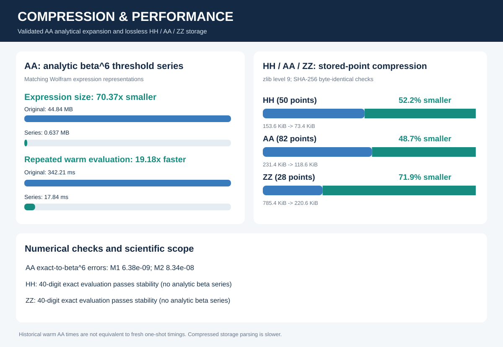

# Verified compression and performance results

These benchmarks distinguish AA analytical beta-series reduction from lossless
stored point-data compression; HH/ZZ analytical beta series are not derived.

## AA analytical beta^6 threshold series

| Metric | Original exact | Beta^6 series | Ratio |
|---|---:|---:|---:|
| Wolfram representation bytes | 44,844,413 | 637,268 | **70.37x smaller** |
| Historical warm median | 342.209 ms | 17.842 ms | **19.18x faster** |

Historical repeat timing from the pinned ggAA-threshold package (Wolfram 13.2,
80 digits, beta=0.1, cos(theta)=0). Not a fresh one-shot Python speedup.
[Upstream source](https://github.com/abhattacharya1992/ggAA-threshold/tree/76491fd105e6f498be51affa213fe6839f879ce6)
[Verification CI](https://github.com/abhattacharya1992/two-loop-dps-prl/actions/runs/44916244758)

## Lossless numerical-point storage (zlib + SHA-256)

| Process | Points | Raw bytes | Packed bytes | Smaller | Raw parse (ms) | Verified packed parse (ms) |
|---|---:|---:|---:|---:|---:|---:|
| HH | 50 | 157276 | 75139 | **52.22%** | 0.0117 | 0.0238 |
| AA | 82 | 236949 | 121491 | **48.73%** | 0.0091 | 0.0215 |
| ZZ | 28 | 804266 | 225887 | **71.91%** | 0.0760 | 0.1445 |

Lossless byte-identical storage savings; decompression plus verified parsing
is slower than raw JSON parsing. No HH/ZZ beta expansion is implied.
[Storage CI](https://github.com/abhattacharya1992/two-loop-dps-prl/actions/runs/44916244758)

## Fresh numerical checks

AA at beta=1/10, cos(theta)=1/3, 120 digits: exact 237.115 s; beta^6 0.0274 s.
Relative errors M1=6.38e-09, M2=8.34e-08. Fresh single-run timings are not historical warm speedups.
[Accuracy-checked AA run](https://github.com/abhattacharya1992/two-loop-dps-prl/actions/runs/44556434508)

**HH:** 40/60/80-digit original-amplitude sweep; lowest stable 40 digits;
accuracy-preserving runtime 66.85 s; high-precision discrepancy 1.78e-51;
archived reference discrepancy 2.81e-27. No analytic beta^6 series.
[Original-amplitude CI](https://github.com/abhattacharya1992/two-loop-dps-prl/actions/runs/44573748819)

**ZZ:** 40/60/80-digit original-amplitude sweep; lowest stable 40 digits;
accuracy-preserving runtime 27.63 s; high-precision discrepancy 4.34e-50;
archived reference discrepancy 2.14e-21. No analytic beta^6 series.
[Original-amplitude CI](https://github.com/abhattacharya1992/two-loop-dps-prl/actions/runs/44578459993)

HH archived reference uses the same analytical evaluator; ZZ FORM reference
independently checks its 36 CF helicity components, not all colour parts.

## Automatic publication

Updated from successful benchmark GitHub Actions artifacts by
the validation-aware update_dashboard.py script and a workflow_run publisher.
Invalid AA accuracy, missing HH/ZZ stability checks, and unsupported
analytical claims cause rejection. Original amplitude evaluations remain manual.
The tracked benchmark_snapshot.json is the machine-readable source.
